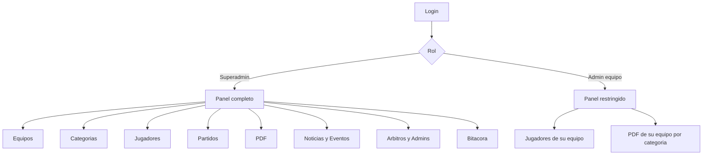
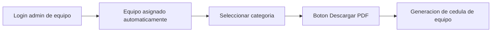

# Manual de Administrador
## Liga Infantil y Juvenil de las Estrellas

## 1. Objetivo
Este manual describe el uso del panel administrativo para gestionar equipos, categorias, jugadores, partidos, PDFs, noticias, eventos, arbitros, administradores y bitacora.

## 2. Acceso al panel
1. Abrir la pagina de administrador.
2. Iniciar sesion con correo y contrasena.
3. El sistema habilita modulos segun rol:
   - Superadmin: acceso total.
   - Admin de equipo: acceso a Jugadores y PDF de su equipo.

## 3. Flujo general del sistema

## 4. Capturas sugeridas
Guarda tus capturas en una carpeta de manual (por ejemplo: img/manual/) y agregalas asi:
- 
- 
- 
- 

## 5. Modulo Equipos
- Crear equipo con nombre y datos opcionales.
- Subir escudo.
- Editar y eliminar equipos.

## 6. Modulo Categorias
- Crear categorias globales.
- Asignar categorias a equipos.
- Eliminar asignaciones cuando aplique.

## 7. Modulo Jugadores
- Registrar jugador por equipo y categoria.
- Capturar datos obligatorios y opcionales.
- Subir fotografia.
- Consultar ficha, editar y eliminar.

## 8. Modulo Tabla de posiciones
- Registrar datos de PJ, G, E, P, GF, GC y puntos.
- Filtrar por categoria.

## 9. Modulo Partidos
- Crear jornadas.
- Programar partidos.
- Registrar resultado.
- Guardar alineaciones y tarjetas.

## 10. Modulo PDF
### 10.1 Cedula por partido
- Requiere partido jugado y alineacion guardada.
- Permite descargar PDF oficial del encuentro.

### 10.2 Cedula por equipo
- Seleccionar equipo y categoria.
- Descargar PDF con plantilla/listado segun configuracion del sistema.

## 11. Modulo Noticias y Eventos
- Publicar, listar y eliminar.
- Se reflejan en el sitio publico.

## 12. Modulo Arbitros
- Registrar arbitros.
- Eliminar arbitros.

## 13. Modulo Administradores
- Crear administradores (super o equipo).
- Para admin de equipo, asignar un equipo.
- Eliminar cuentas cuando sea necesario.

## 14. Modulo Bitacora
- Consulta de acciones administrativas.
- Filtro por rol (super/equipo).
- Uso para auditoria.

## 15. Flujo PDF admin de equipo

## 16. Solucion de problemas
- Si no cargan datos: verificar conectividad API y sesion.
- Si no descarga PDF: validar categoria seleccionada.
- Si no aparecen modulos: revisar rol del usuario.
- Si no se ven cambios: recargar con Ctrl + F5.
