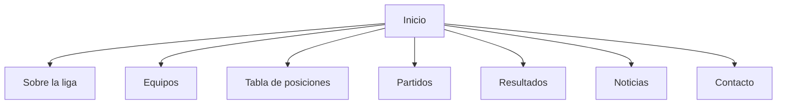
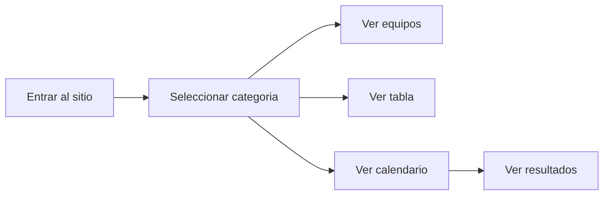

# Manual de Usuario Final
## Liga Infantil y Juvenil de las Estrellas

## 1. Objetivo
Este manual explica como navegar y consultar informacion del sitio publico de la liga.

## 2. Navegacion principal
- Inicio
- Sobre la liga
- Equipos
- Tabla de posiciones
- Partidos
- Resultados
- Noticias
- Contacto
- Acceso a Administrador

## 3. Mapa de secciones

## 4. Capturas sugeridas
Guarda tus capturas en una carpeta de manual (por ejemplo: img/manual/) y agregalas asi:
- 
- 
- 
- 
- 

## 5. Seccion Inicio
- Presenta informacion general de temporada.
- Incluye accesos rapidos a calendario y tabla.

## 6. Seccion Sobre la liga
Muestra:
- Numero de equipos inscritos.
- Numero de categorias.
- Goles al momento.
- Principios de formacion y valores.

## 7. Seccion Equipos
- Permite filtrar por categoria.
- Muestra tarjetas de equipos.
- Al hacer clic en un equipo, abre modal con informacion de contacto.

## 8. Seccion Tabla de posiciones
- Seleccionar categoria.
- Consultar:
  - PJ (Partidos Jugados)
  - G (Ganados)
  - E (Empatados)
  - P (Perdidos)
  - GF (Goles a Favor)
  - GC (Goles en Contra)
  - DG (Diferencia de Goles)
  - Pts (Puntos)

## 9. Seccion Partidos (Calendario)
Filtros disponibles:
- Jornada
- Arbitro
- Equipo
- Categoria

Permite revisar partidos programados con fecha, hora y sede.

## 10. Seccion Resultados
- Muestra los encuentros ya jugados.
- Presenta marcador final por partido.

## 11. Seccion Noticias
- Carrusel de noticias recientes.
- Publicaciones administradas desde el panel admin.

## 12. Seccion Contacto
- Datos de contacto oficiales.
- Acceso a redes sociales.
- Ubicacion por mapa.

## 13. Flujo recomendado de consulta

## 14. Preguntas frecuentes
- No veo informacion: recargar pagina con Ctrl + F5.
- No aparece tabla: seleccionar categoria.
- No abre modal de equipo: volver a intentar clic en la tarjeta.
